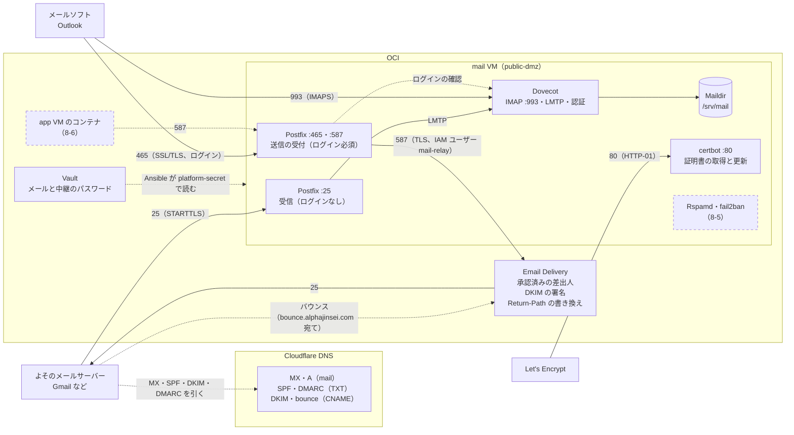
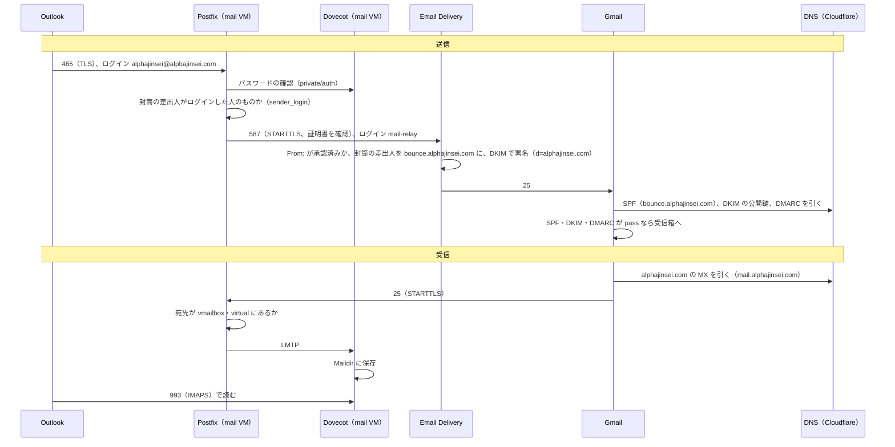

# 個人サービス公開インフラ 方式検討：OCI のメール基盤

最終更新：2026-11-05

[方式検討：OCI](oci.md) の別冊。共通基盤の mail VM に、`alphajinsei.com` のメールの送受信の基盤を作る。仕組みの基礎は [番外編：メールの仕組み](../notes/extra-mail-basics.md)、組みながら分かったことは [番外編：メールサーバーを組む](../notes/extra-mail-build.md)、手順は [学習ロードマップ：OCI](../roadmaps/oci.md) の Step 8。

## 1. ゴール

- `alphajinsei@alphajinsei.com` で、メールを送り、受け取れる（別のアドレスへの転送ではなく、メールボックスを自分で持つ）。
- 共通基盤のアプリが、`alphajinsei.com` の差出人で通知などのメールを送れる。
- 仕組みを部品から理解する。業務で SPF・DKIM・DMARC を付けたときに見えなかった全体像を、自分で組んで確かめる。

自前のメールが安定するまで、大事なアカウント（銀行、パスワードの再設定先など）の連絡先には使わない。

## 2. 要件

### 機能

| # | 要件 | 決めたこと |
| --- | --- | --- |
| 1 | 受信 | MX を `mail.alphajinsei.com`（mail VM）に向け、25番で受ける。存在しない宛先は受け取りを拒否する |
| 2 | 保存 | ユーザーは1人（`alphajinsei@alphajinsei.com`）。エイリアスは `postmaster@`（RFC で必須）、`abuse@`、`dmarc@`（DMARC のレポートの受け口）を同じメールボックスに |
| 3 | 閲覧 | メールソフト（IMAP、993番）。Webメールは後で、共通基盤のアプリとして足す（Roundcube を app VM に） |
| 4 | 送信の受付 | 465・587番。ログインしてから受け付ける。オープンリレーにしない |
| 5 | 外への配送 | OCI Email Delivery に中継する（OCI は外へ出る 25番を塞いでいる） |
| 6 | アプリからの送信 | app VM のコンテナ → mail VM → Email Delivery（8） |

### 届くこと

- SPF・DKIM・DMARC をそろえ、DMARC のアライメントを取る（5）。
- 送信の IP の評判と逆引きは、中継する Email Delivery のものになる。
- TLS：メールソフトとの間は必須。サーバー同士は相手が対応していれば使う（STARTTLS）。証明書は公的な CA（Let's Encrypt）。メールは Cloudflare のプロキシを通らないので、Origin 証明書は使えない。

### 運用

- 迷惑メールのフィルター（受け取る側としての SPF・DKIM・DMARC の確認を含む）と、ログインの総当たりへの対策。
- メールボックスのバックアップ。
- 送信待ちのキュー、バウンス、DMARC のレポートを見られること。
- 停止：数時間は許す（送る側が数日は再送する）。VM の停止は Step 7 のアラームで分かる。

## 3. 方式の比較

| 案 | 中身 | 学び | 手間 | 届きやすさ |
| --- | --- | --- | --- | --- |
| **A. 部品を自分で組む（採用）** | Postfix、Dovecot、Rspamd、certbot を Ansible で入れる。送信は Email Delivery に中継 | ◎ 1つずつ仕組みが分かる | 大 | ○ 送信は中継先の評判 |
| B. 一式のパッケージ | docker-mailserver（A の部品を1コンテナに）、Stalwart（1つのプログラムで全部） | ○ 設定ファイルの単位で分かる | 中 | ○ |
| C. 重めの一式 | Mailcow、Mailu（管理画面、Webメール付き） | △ 中が見えにくい | 小〜中 | ○ |
| D. マネージド | Google Workspace、Zoho、Migadu、iCloud+ の独自ドメイン | × | 最小 | ◎ |

- 目的が「部品から理解すること」なので A。実務の個人の独自ドメインのメールは D が主流で、比較の基準として置く。
- Cloudflare Email Routing（受けて別のアドレスへ転送するだけ）は、メールボックスを自分で持たないので対象外。

## 4. 構成

実線は Step 8-4 までに作ったもの、点線の枠は 8-5・8-6 で足すもの。

メールの流れ（送信と受信）：

| 部品 | 役割 |
| --- | --- |
| Postfix | MTA（25番）と MSA（465・587番）。受けたメールを Dovecot に渡し、送るメールを Email Delivery に中継する |
| Dovecot | IMAP（993番）、メールボックスへの保存（LMTP）、ログインの確認（Postfix の SASL もここを使う） |
| Rspamd（と Redis）（8-5） | 受け取ったメールの点数付け（迷惑メールの判定、SPF・DKIM・DMARC の確認）。送るメールへの DKIM の署名 |
| certbot | Let's Encrypt の証明書の取得と自動更新 |
| fail2ban（8-5） | ログインの失敗が続く IP を、しばらく締め出す |

- すべて Ubuntu のパッケージで入れ、Ansible のロール `mail` にする。Docker は使わない（メールは状態を持ち、ポートを直接受けるので、VM 単体で動かす。[oci.md の 2](oci.md#2-全体の構成)）。
- メールボックスは Maildir（1通1ファイル）で `/srv/mail` に置く（[oci.md の 3](oci.md#3-always-free-の枠と割り振り)）。

## 5. 送信の経路と、DMARC のアライメント

Email Delivery の仕様（2026-11 に公式の資料で確認）：

- **承認済みの差出人**（Approved Sender）を `From:` のアドレスごとに登録する。登録していない `From:` は拒否される（＝差出人の制限にもなる）。
- 認証は SMTP の資格情報（IAM のユーザーに紐づく。1ユーザーに2つまで）。中継専用の IAM のユーザー `mail-relay`（グループ `mail-relay`、権限は `use approved-senders` だけ）を Terraform で作り、資格情報のパスワードは Vault（`mail-relay-smtp-password`）へ。Ansible が mail VM の `/etc/postfix/sasl_passwd`（root だけが読める）に書く。
- Email Delivery の設定（Email Domain、DKIM、カスタム Return-Path、承認済みの差出人）も Terraform（`terraform/mail.tf`）。DNS のレコードは、その出力を `cloudflare.tf` が Cloudflare に書く。
- 受信の機能はない（送信専用）。
- **何もしないと、封筒の差出人は Oracle のドメインになる**（バウンスを Email Delivery が受けるため）。SPF は Oracle のドメインで通るが、`From:` と一致しないので、DMARC には効かない。

アライメントの取り方は2つあり、両方そろえる。

| 仕組み | どうするか | DMARC に効く理由 |
| --- | --- | --- |
| DKIM | `d=alphajinsei.com` で署名する。**Email Delivery に署名してもらう**（Email Domain の DKIM。鍵は Email Delivery が持ち、公開鍵は CNAME で指す）。自分で署名する（Rspamd）のは、8-5 で別のセレクターで足すかを決める | 署名のドメインが `From:` と一致する |
| SPF | カスタム Return-Path：封筒の差出人を `bounce.alphajinsei.com` のような自分のサブドメインにしてもらう（CNAME を置く） | 封筒の差出人が `From:` の親ドメインと一致する（relaxed） |

- `alphajinsei.com` の SPF は、Email Delivery だけを許す（`include:ap.rp.oracleemaildelivery.com`）。mail VM の IP からは外へ送らないので載せない。
- DMARC は `p=none` で始め、レポート（`dmarc@`）で全部通ることを確かめてから `quarantine` に上げる。

## 6. DNS のレコード

Cloudflare に置き、oci-platform の `cloudflare.tf` で Terraform が持つ（[oci.md の 7](oci.md#7-ssh-と構成管理)。自分が作ったレコードだけを Terraform で持つ）。

| 名前 | 種類 | 中身 | 用途 |
| --- | --- | --- | --- |
| `mail.alphajinsei.com` | A | mail VM の公開 IP。**プロキシしない**（Cloudflare は SMTP や IMAP を通さない） | MX の向け先、メールソフトの接続先 |
| `alphajinsei.com` | MX | `10 mail.alphajinsei.com` | 受信 |
| `alphajinsei.com` | TXT | `v=spf1 include:ap.rp.oracleemaildelivery.com -all` | SPF |
| `oci-nrt-20261105._domainkey.alphajinsei.com` | CNAME | Email Delivery 側の公開鍵（TXT） | DKIM |
| `bounce.alphajinsei.com` | CNAME | Email Delivery 側（SPF とバウンスの受け口の MX） | カスタム Return-Path |
| `_dmarc.alphajinsei.com` | TXT | `v=DMARC1; p=none; rua=mailto:dmarc@alphajinsei.com` | DMARC |

- mail VM の公開 IP は予約しない（エフェメラル）。A レコードは Terraform が VM の IP を参照して書くので、VM を作り直しても apply で追いつく。
- `mail.alphajinsei.com` はプロキシしないので、mail VM の IP は公開される。LB とは別の IP で、Web の経路には影響しない。

## 7. 証明書とアカウント

- **証明書**：Let's Encrypt で `mail.alphajinsei.com` を取り、certbot が自動で更新する。取り方は次の2つを比べた。
  - HTTP-01：mail VM の 80番を開け、更新のときだけ certbot が受ける。開けるポートが1つ増える。
  - DNS-01：Cloudflare の API トークン（DNS の編集）を mail VM に置く。トークンはゾーン単位でしか絞れず、mail VM が乗っ取られると DNS 全体を書き換えられる。
  - **HTTP-01 にした**（被害の範囲が小さい）。DNS-01 を選ぶのは、ワイルドカードの証明書が要るとき、外から 80番で届かないサーバー（社内のサーバーなど）のとき、多数のサーバーの証明書を1か所でまとめて取るとき。その場合も、トークンを外に公開するサーバーに置かず、取る専用の場所に置くのが定石。
- **アカウント**：ユーザーは1人なので、Dovecot のパスワードのファイル（passwd-file）にハッシュで持つ。パスワードは DB と同じく Terraform が作って Vault に入れ（`mail-<ユーザー>-password`、`terraform/mail.tf`）、mail VM の Ansible が `platform-secret` で読んで SHA512-CRYPT のハッシュにする。自分は手元の oci CLI で一度だけ取り出し、メールソフトとパスワード管理のツールに入れる。
- **保存**：Postfix は受け取るだけにし、Dovecot に LMTP で渡す。Dovecot が Maildir に書き、索引も持つ（IMAP が速い。あとで振り分けのルール（Sieve）も足せる）。

## 8. アプリからの送信

| 案 | 流れ | 特徴 |
| --- | --- | --- |
| **① mail VM を通す（採用）** | コンテナ → mail VM の 587番（VCN の中）→ Email Delivery | 送信の出口が1か所。キュー（再送）、DKIM の署名、ログが mail VM にまとまる。業務の「社内の SMTP リレー」の形 |
| ② 直接送る | コンテナ → Email Delivery の SMTP | mail VM が要らない。SES や SendGrid に直接送る、クラウドで一般的な形。SMTP の資格情報（1ユーザーに2つまで）をアプリに配る |

- 学ぶためと、出口を1つにするために①。
- 足すもの：NSG の mail に「nsg-app から 587番」（今は 587番を全体に開けているので、すでに通る）、差出人の制限（`noreply@alphajinsei.com` など。Email Delivery の承認済みの差出人とも二重になる）。
- 認証は Step 8-6 で比べて決める。送信元の IP（app VM）で信頼する案は簡単だが、app のどのコンテナでも送れる。アプリごとのパスワード（DB と同じく Terraform が作って Vault に入れる）はアプリごとに止められるが、mail VM の Dovecot への登録を、共通基盤とアプリのどちらが持つかを決める必要がある。

## 9. 運用

| もの | 使い方 |
| --- | --- |
| バックアップ | `/srv/mail` を Object Storage に定期的に退避する（ops か mail の cron）。ブートボリュームのバックアップも併用 |
| 監視 | VM の停止は Step 7 のアラーム。メールの中の異常（キューの詰まり、証明書の期限）は、まずは手で見る |
| ログ | `/var/log/mail.log`（Postfix と Dovecot）。送れなかったメールは `postqueue -p` |
| 証明書 | certbot の systemd のタイマーが1日2回確かめ、期限の30日前から更新する。更新したら deploy フック（`/etc/letsencrypt/renewal-hooks/deploy/reload-mail.sh`）で Postfix と Dovecot を読み直す |
| DMARC のレポート | `dmarc@` に届く XML を見る。読みやすくする道具は必要になったら |
| 更新 | 共通基盤の OS の更新（unattended-upgrades と `upgrade.yml`）に乗る |

## 10. 要確認

- Email Delivery の無料枠：二次的な資料では「1日100通、月3,000通」。公式の Always Free のページでは未確認。Cost Analysis で0円を確かめる。
- 逆引き（PTR）：OCI の公開 IP の PTR は、サポートへの依頼で設定してもらう形（A レコードを先に作っておく）。送信は Email Delivery を通すので必須ではない。エフェメラルな IP は作り直すと変わるので、頼むなら予約パブリック IP にしてから。

## 11. 検討の経緯

1. **当初の案**（oci.md の 10）：受信は自前、送信は Email Delivery に中継、SPF・DKIM・DMARC を Cloudflare に。この骨格はそのまま。
2. **別冊に分けた**：要件・方式・DNS・アライメントまで書くと oci.md の1節に収まらないので、この文書に分けた。基礎の解説は番外編に置いた。
3. **方式：部品を自分で組む（A）**：パッケージやマネージドと比べ、仕組みを理解する目的に合う A にした（3）。
4. **閲覧はメールソフトから**：IMAP はどの方式でも作る土台で、Webメールはその上の便利さ。Webメールは共通基盤のアプリとして後で足す。
5. **アプリからの送信は mail VM を通す**：Email Delivery に直接送る案と比べ、出口を1つにする形を学ぶために mail VM を通す（8）。
6. **証明書は HTTP-01**：DNS-01 は Cloudflare のトークンを外に公開する mail VM に置くことになり、乗っ取られたときに DNS 全体を書き換えられる。80番を開けるだけの HTTP-01 にした（7）。
7. **メールのパスワードは Terraform → Vault**：DB のパスワードと同じ形。ハッシュを公開リポジトリに置く案は、弱いパスワードだと手元で総当たりされるので見送った（7）。
8. **DKIM は Email Delivery に署名してもらう**：鍵の管理と DNS（CNAME）が Terraform だけで済み、Email Delivery の送信の上限の引き上げにも DKIM が要る。自分で署名する（Rspamd）のは学びのために後から足せる（5）。
9. **構成図を Mermaid にした**：8-4 で送受信がそろったところで、作ったとおりの構成（Rspamd・fail2ban・アプリからの送信は点線）と、送信・受信の流れを図にした。GitHub でそのまま描かれる。
