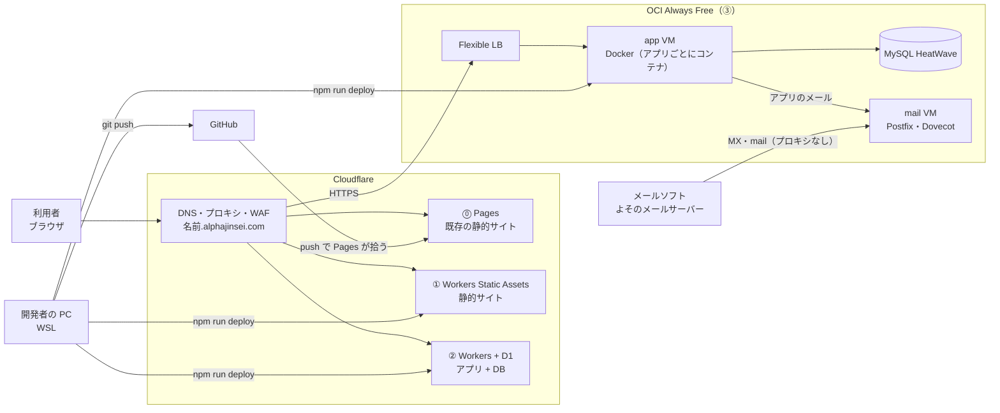

# 個人サービス公開インフラ 方式検討：全体

最終更新：2026-11-06

個人サービスを公開する基盤を、どの方式で持つかの検討の入口。全方式に共通の要件と方式の一覧をここに置き、方式ごとの構成と検討の経緯は、それぞれの資料に分ける。

| 資料 | 対象 |
| --- | --- |
| [Cloudflare](cloudflare.md) | 方式⓪①②（標準）。CI/CD の検討もここ |
| [OCI](oci.md) | 方式③（汎用VM：共通基盤 + コンテナ） |

サービスを作るときに読むのは [サービス開発ガイド](../service-guide.md)、基盤ごとの資料（[Cloudflare](../platforms/cloudflare.md)、OCI は oci-platform の README）、各サンプルの README。この資料は「なぜそうしたか」を残すためのもの。

## ねらい

- **開発ではインフラのことを考えない。** インフラ層は中で実装し、外には仕様（アプリが受け取るものと守ること）だけを見せる。Claude の skill のように、再利用できる部品として切り出す。アプリを作るときは、その仕様だけを読めばよい状態にする。
- **自分が管理する基盤を持つ。** 個人で基盤を持ち、OS の更新、脆弱性への対応、暗号の移行（PQC など）を自分の手で回すと、インフラの基礎が自然に身に付く。基盤には制約がつきもので、ここでは「無料枠の中で良い基盤を持つ」ことを制約にする。

## 期待する要件

| # | 要件 | 優先度 | 内容 |
| --- | --- | --- | --- |
| R1 | 定常コストゼロ | 必須 | 常時動かすものは無料枠で運用する。学習のための一時的な課金は可 |
| R2 | 手軽なデプロイ | 必須 | 面倒な手順なしにデプロイ・更新できる（`npm run deploy` の1コマンド）。サービスを今後いくつも追加でき、立ち上げを CLI で完結できる |
| R3 | プロジェクト内完結 | 強く希望 | 1つのディレクトリにアプリとインフラのコードが揃い、サービスを全レイヤ分そこで説明しきれる（方式③は、共通基盤のリポジトリとアプリのリポジトリの2段になる） |
| R4 | 構成管理 | できれば | Terraform / Ansible でコード化する（学習も兼ねる）。Claude が自分で触れる形にしておくと、開発が速くなる |
| R5 | 対象構成 | 必須 | (a) 静的コンテンツ配信のみ、(b) アプリケーションサーバ + DB |
| R6 | 性能 | 考慮不要 | 個人サイト程度のアクセス |

前提：ドメイン（alphajinsei.com）はお名前.comで取得済みで、DNS は Cloudflare で運用中。静的サイトは Cloudflare Pages + GitHub 連携で運用実績あり（dia-logos）。保育園のページは Cloudflare Access で保護中。アプリの言語は未定（AI で生成する前提）。

## 方式の一覧

新しいサービスはまず標準方式（①②）で作り、そこで実現できないときだけ他の方式を使う。既存の Pages のサイトは⓪として、そのまま残す。

Web の入口はどの方式も Cloudflare の DNS とプロキシで、DNS の向け先を変えるだけで方式をまたいで移せる。メールだけは Cloudflare を通らず、mail VM に直接届く。アプリからのメールも mail VM を通って外へ出る。

| 方式 | 構成 | 使う場面 | 資料 |
| --- | --- | --- | --- |
| ⓪ 既存・Pages | Cloudflare Pages + GitHub 連携（push でデプロイ） | 既存のサイト（dia-logos）だけ。新しいサービスには使わない | [Cloudflare](cloudflare.md) |
| ① 標準・静的 | Cloudflare Workers Static Assets（コードのない Worker）。Markdown なら Astro でビルド | 静的サイト、SPA | [Cloudflare](cloudflare.md) |
| ② 標準・アプリ + DB | Cloudflare Workers + D1（必要に応じて R2 / Access / Cron）。TypeScript + Hono + Drizzle | DB を使うアプリ全般。既定の選択肢 | [Cloudflare](cloudflare.md) |
| ③ 汎用VM | OCI Always Free の共通基盤（Cloudflare → LB → Docker ホスト → MySQL HeatWave）。VM 単体のサービス（メールなど）も同じ VCN に置く | Workers で動かないもの（常駐プロセス、任意の言語、コンテナで動かしたいもの、自前のメールサーバー） | [OCI](oci.md) |
| ④ 学習方式 | AWS Lambda + DynamoDB、GCP Cloud Run + Firestore、Azure Functions + Azure SQL など | 大手クラウドを触る目的で、1サービスずつ試す | 未作成 |

## 検討した選択肢

大手クラウドは「常時稼働する VM や DB」が無期限無料にならず、課金の上限もないため学習方式に回す。OCI だけは Always Free の範囲が広く、LB・VM・DB のそろった構成が無料で組めるので、方式③に使う。数値は検討時点の概算（OCI は 2026-11-03 に公式ドキュメントで確認）。

| 選択肢 | 種類 | 無期限の無料枠（概算） | 判断 |
| --- | --- | --- | --- |
| AWS | 大手クラウド | Lambda 月100万リクエスト、DynamoDB 25GB。EC2/RDS は新規アカウントのクレジットのみ | 学習方式 |
| GCP | 大手クラウド | Cloud Run 月200万リクエスト、Firestore 1GB、e2-micro 1台。Cloud SQL は無料なし | 学習方式 |
| Azure | 大手クラウド | Functions、Cosmos DB 無料枠、Azure SQL Database 無料オファー | 学習方式 |
| OCI | 大手クラウド | A1（Arm）計2 OCPU / 12GB、AMD マイクロ VM 2台、ディスク計200GB、Flexible LB 1台、MySQL HeatWave 1台、Autonomous DB 2つ ほか | 方式③。詳細は [OCI](oci.md) |
| Neon | DBのみ（PostgreSQL） | 0.5GB/プロジェクト。未使用で自動停止し、次の接続に待ちが発生 | 保留。PostgreSQL 必須なら Workers + Hyperdrive と組む |
| Supabase | DB + 認証/ストレージ/API | 500MB、2プロジェクト。1週間未使用で一時停止 | 保留 |
| Render | アプリ実行（Heroku型） | Webサービスは15分未使用でスリープ。無料の PostgreSQL は期限付き | 不採用 |
| Fly.io / Railway | アプリ実行 | 実質的に有料 | 不採用 |

## 次のステップ

- [x] 標準方式（Workers + D1）のサンプルを作り、サービス開発ガイドにまとめる（[学習ロードマップ：Cloudflare](../roadmaps/cloudflare.md)）
- [x] 方式③の共通基盤とサンプルを作る（[学習ロードマップ：OCI](../roadmaps/oci.md)）
- [ ] Cloudflare 以外の無料枠の数値を、各社の公式ページで確認する
