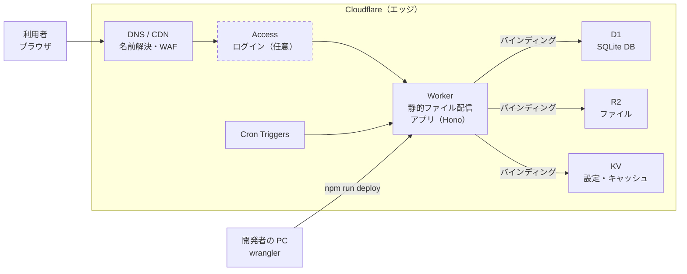

# 個人サービス公開インフラ 方式検討サマリ

最終更新：2026-11-03

個人サービスは Cloudflare（Workers + D1 ほか）を標準基盤とし、1サービス＝1ディレクトリでアプリからインフラまで完結させる。

## 期待する要件

| # | 要件 | 優先度 | 内容 |
| --- | --- | --- | --- |
| R1 | 定常コストゼロ | 必須 | 常時動かすものは無料枠で運用する。学習のための一時的な課金は可 |
| R2 | 手軽なデプロイ | 必須 | 面倒な手順なしにデプロイ・更新できる（`npm run deploy` の1コマンド）。サービスを今後いくつも追加でき、立ち上げを CLI で完結できる |
| R3 | プロジェクト内完結 | 強く希望 | 1つのディレクトリにアプリとインフラのコードが揃い、サービスを全レイヤ分そこで説明しきれる |
| R4 | 構成管理 | できれば | Terraform / Ansible でコード化する（学習も兼ねる） |
| R5 | 対象構成 | 必須 | (a) 静的コンテンツ配信のみ、(b) アプリケーションサーバ + DB |
| R6 | 性能 | 考慮不要 | 個人サイト程度のアクセス |

前提：ドメイン（例：alphajinsei.com）はお名前.comで取得済みで、DNSはCloudflareで運用中。静的サイトは Cloudflare Pages + GitHub連携で運用実績あり（dia-logos）。保育園のページは Cloudflare Access で保護中。アプリの言語は未定（AIで生成する前提）。

## 推奨構成と理由

構成は4つの方式に分ける。新しいサービスはまず標準方式で作り、そこで実現できないときだけ他の方式を使う。

| 方式 | 構成 | 使う場面 |
| --- | --- | --- |
| ① 標準・静的 | Cloudflare Workers Static Assets（コードのない Worker）。Markdown なら Astro でビルド | 静的サイト、SPA |
| ② 標準・アプリ + DB | Cloudflare Workers + D1（必要に応じて R2 / Access / Cron）。TypeScript + Hono + Drizzle | DBを使うアプリ全般。既定の選択肢 |
| ③ 学習方式 | AWS Lambda + DynamoDB、GCP Cloud Run + Firestore、Azure Functions + Azure SQL など | 大手クラウドを触る目的で、1サービスずつ試す |
| ④ 汎用VM方式 | OCI Always Free VM + Docker + Dokploy/Coolify + Cloudflare Tunnel | Workersで動かないもの（常駐プロセス、任意の言語、PostgreSQLが必須なもの） |

標準を Cloudflare にする理由：

- R1 コスト：無料プランに請求が発生しない。上限を超えると止まるだけで、AWS等のような課金事故が起きない。
- R2 デプロイ：wrangler の CLI だけでデプロイできる（GitHub Actions などから呼べば git push でのデプロイにもできる）。サービス追加はリポジトリを増やすだけ（詳細は「CI/CD」）。
- R3 完結性：共通基盤がアカウントとDNSゾーンだけで、他はすべてサービスの `wrangler.jsonc` と Terraform に書ける。
- R4 構成管理：Terraform の Cloudflare provider で DNS・Access・R2・D1 を管理できる。
- 既存資産：DNS・Pages・Access をすでに運用しており、管理画面も運用の流れも増えない。

制約：Workers の実行環境は V8 isolate（コンテナやVMではない）。そのため動くのは JS/TS が中心で、Python は制約付き、Rust/Go などは WebAssembly 経由となる。DB は SQLite（D1）。



リクエストは DNS/CDN と（必要なら）Access を通って Worker に届き、Worker はバインディングで D1・R2・KV を使う。アプリのデプロイは、手元の PC から wrangler で行う（GitHub はコードの保管場所）。

## 検討した選択肢

大手クラウドは「常時稼働するVMやDB」が無期限無料にならず、課金の上限もないため学習方式に回す。数値は検討時点の記憶による概算で、採用前に公式ページでの確認が必要。

| 選択肢 | 種類 | 無期限の無料枠（概算） | 判断 |
| --- | --- | --- | --- |
| AWS | 大手クラウド | Lambda 月100万リクエスト、DynamoDB 25GB。EC2/RDS は新規アカウントのクレジットのみ | 学習方式 |
| GCP | 大手クラウド | Cloud Run 月200万リクエスト、Firestore 1GB、e2-micro 1台。Cloud SQL は無料なし | 学習方式 |
| Azure | 大手クラウド | Functions、Cosmos DB 無料枠、Azure SQL Database 無料オファー | 学習方式 |
| OCI | 大手クラウド | ARM VM 計4コア/24GB、Autonomous DB 2インスタンス（各約20GB） | 汎用VM方式。ADB は未使用で停止・回収、プライベートエンドポイント不可 |
| Neon | DBのみ（PostgreSQL） | 0.5GB/プロジェクト。未使用で自動停止し、次の接続に待ちが発生 | 保留。PostgreSQL必須なら Workers + Hyperdrive と組む |
| Supabase | DB + 認証/ストレージ/API | 500MB、2プロジェクト。1週間未使用で一時停止 | 保留 |
| Render | アプリ実行（Heroku型） | Webサービスは15分未使用でスリープ。無料のPostgreSQLは期限付き | 不採用 |
| Fly.io / Railway | アプリ実行 | 実質的に有料 | 不採用 |

## 設計上の論点

### 共通基盤とサービス固有の境界

共通基盤は小さく保ち、それ以外はすべてサービスのディレクトリに置く。

| 層 | 含むもの | 置き場所 |
| --- | --- | --- |
| 共通基盤 | Cloudflareアカウント、DNSゾーン、Terraform state 用の R2 バケット、（使うなら）VM と Tunnel | platform リポジトリ |
| サービス固有 | アプリコード、DBとスキーマ、サブドメイン、Cron、Access、CI/CD | 各サービスのリポジトリ |

標準方式のサービスのディレクトリ構成例：

```
my-service/
├── src/                 # アプリ（Hono 等）
├── migrations/          # D1 のスキーマ（SQL）
├── wrangler.jsonc       # Worker定義：D1/R2/Cron の紐付け、カスタムドメイン
├── infra/terraform/     # Access など wrangler で扱えないもの
└── .github/workflows/   # push でデプロイしたくなった場合のみ（いまは置かない）
```

### アプリとDBの間の通信

標準方式では D1 を使うため、この懸念は発生しない。Worker から D1 へはバインディングで接続し、接続文字列もパスワードも不要で、DBがインターネットに公開されない。

外部のDBサービス（Neon 等）や無料版の OCI ADB では、通信がインターネットを経由する。その場合は「経路は信用せず、TLSと認証で守る」ゼロトラストの考え方で対応する。実務上は遅延の方が問題になりやすく、Hyperdrive で接続をプールして緩和する。個人サイトのため、個人情報などの機密データは扱わない前提とする。

### 汎用VM方式の Docker と冗長性

- Docker は冗長化のためではなく、依存関係の分離（1台のVMで複数サービスのミドルウェアが衝突しない）、再現性、`Dockerfile` でサービスのディレクトリ内に完結させるために使う。
- 冗長化はしない。VM 1台が単一障害点になることを受け入れ、Terraform + Ansible で「作り直せば元に戻る」状態を保つ。
- DB は日次で R2 にバックアップする。目標は RTO 数時間、RPO 1日。

## CI/CD

インフラの構成（どこで動かすか）を決めたあと、学習ロードマップの Step 6 で「どうデプロイするか」を検討した。結論は、**アプリ（方式②）も静的サイト（方式①）も、手元の PC から `npm run deploy` でデプロイし、git は保管用に適宜 push する**。`deploy` スクリプトの中身だけが違う（アプリはマイグレーション＋`wrangler deploy`、静的サイトは `astro build`＋`wrangler deploy`）。

一度は「GitHub Actions で main への push をデプロイにする」と決めて、サンプルで実際に動かした。そのうえで、使ってみた感触から手元のデプロイに戻した。

### 経緯

1. 静的サイト（dia-logos の Pages）と同じく、git push でデプロイする前提で考え始めた。
2. 方式を3つ比べ（下の表）、立ち上げを CLI で完結でき（Claude が代わりにできる）、デプロイ忘れも起きない GitHub Actions を採用した。サンプルでは、コードのデプロイも、列の追加のマイグレーションも Actions で本番に流れた。
3. 使ってみると、push が「本番に出す」操作になり、push の重みが増した。失敗するかもしれない変更は push できなくなり、開発中に考えることが増えた。個人開発で、git と本番の一致までの統制は求めていない。git はコードをインターネット上に保管しておく場所で十分。
4. そこで、アプリは「`wrangler dev` で確かめて `wrangler deploy` で出す。git は適宜 push」に変更した。
5. 静的サイトは、当初「失敗しようがないので push デプロイの便利さを取る」つもりだった。しかし既存のサイト（blog など）は Markdown を SSG（Astro）でビルドする形で、ビルドの工程がある。方式をアプリとそろえるほうが素直なので、静的サイトも `npm run deploy`（手元でビルドしてデプロイ）にした。手元でビルドすれば、`astro dev` で見ていたものと同じ成果物がそのまま出る。

### 検討した案

| 観点 | A. Workers Builds（GitHub 連携） | B. 手元の wrangler | C. GitHub Actions |
| --- | --- | --- | --- |
| 仕組み | Cloudflare が GitHub App 経由で push を受け取り、リポジトリを取りに行ってビルド・デプロイする | 手元の PC で `wrangler deploy` を実行する | push のたびに GitHub が使い捨ての Ubuntu を用意し、手元と同じ wrangler のコマンドを実行する |
| push の意味 | 本番へのリリース | コードの保管 | 本番へのリリース |
| 既存方式（dia-logos の Pages）との整合性 | ◎ 同じ方式 | △ push とデプロイが別の操作になる | ○ 体験は同じ（push ＝ デプロイ）、仕組みが違う |
| 初期設定の手間（サービスごと） | △ ダッシュボードでリポジトリの接続が要り、Claude が代わりにできない | ◎ ほぼゼロ | ○ ワークフローはテンプレートに入れておける。シークレットの登録は `gh secret set` で CLI からできる |
| 改修のときの取り回し | ○ push するだけだが、push の重みが増す | ◎ 確かめて、出したいときに出す。ただしログイン済みの PC からしかできない | ○ A と同じ |
| 本番 ＝ git の main が保証されるか | ◎ | △ 保証されない（個人開発なので受け入れる） | ◎ |
| 認証 | Cloudflare が管理（GitHub App とビルド用トークンを自動作成） | 手元の `wrangler login` | Cloudflare の API トークンを GitHub の Secrets に預ける |
| DB マイグレーション | Deploy command に含めればできる | デプロイのスクリプトに含める | ワークフローに含める |

- A と C は矢印の向きが逆。A は Cloudflare が GitHub から取りに行き（GitHub へのアクセス権を Cloudflare に渡す）、C は GitHub が Cloudflare に送り込む（Cloudflare の API トークンを GitHub に預ける）。
- B も CLI だけで完結するので、「Claude が代わりにできる」という点は満たしている。

### 採用した構成（アプリ：方式②）

- 開発は `npx wrangler dev`（ローカルの D1）で確かめ、本番へは `npm run deploy` で出す。`package.json` の `deploy` スクリプトに、マイグレーションの適用とデプロイをまとめ、マイグレーションの流し忘れを防ぐ。デプロイの履歴にコミットを残したい場合は、`wrangler deploy` に `--message "$(git describe --always --dirty)"` を付ける（サンプルではシンプルさを優先して付けていない）。

```json
"deploy": "wrangler d1 migrations apply DB --remote && wrangler deploy"
```

- git は適宜 push する。push はデプロイと関係しない。
- GitHub Actions のワークフローと、GitHub の Secrets は置かない。

### 運用のルール

- デプロイの経路は1つに絞る。同じ Worker に、手元の `wrangler deploy` と Workers Builds や Actions からのデプロイを混ぜると、後から出したほうが本番になり、本番の中身がどこ由来か分からなくなる（Cloudflare から見るとどれも同じ API 呼び出しで、区別がつかない）。
- `drizzle-kit generate` は手元で実行し、生成された SQL を読んでから `npm run deploy` する。
- ブランチごとのプレビューは使わない。確かめるのは `wrangler dev` で行う。プレビューを使うと本番と同じ D1 につながり、本番のデータに触れてしまう。

### 静的サイト（方式①）と既存の Pages

| | アプリ（方式②） | 静的サイト（方式①、SSG） |
| --- | --- | --- |
| 手元で確かめる | `npx wrangler dev` | `npm run dev`（`astro dev`）。本番と同じ workerd で見るなら `npm run preview` |
| `npm run deploy` の中身 | `wrangler d1 migrations apply DB --remote && wrangler deploy` | `astro build && wrangler deploy` |
| `wrangler.jsonc` | `main` ＋ `assets` ＋ `d1_databases` | `assets`（`./dist`）だけ。`main` はない |
| サンプル | `sample-cf-workers-d1` | `sample-cf-workers-static` |

- 静的サイトは Pages ではなく Workers Static Assets にする。静的ファイルの配信に限れば機能はほぼ同じだが、Cloudflare は新機能を Workers 側に入れていて、新しく作るなら Workers を勧めている。あとで API（問い合わせフォームなど）を足したくなったら、同じ Worker に `main` を足すだけで済む。Pages にしかない実行環境はない（Pages Functions も中身は workerd）。
- 完全な静的サイトなら、Astro の Cloudflare アダプターは要らない。`astro build` の出力（`dist/`）を `assets` で配るだけ。`build.format: 'file'` にすると `posts/hello.html` の形で出力され、`/posts/hello` にリダイレクトなしで応答する。
- 記事の公開が「この PC から `npm run deploy`」になり、スマホや GitHub の画面から書いて公開することはできない。必要になったら GitHub Actions を足す（下の参考の構成から、D1 の行をビルドの行に替える）。
- 既存の Pages（dia-logos）は、現状の GitHub 連携のまま運用する。Pages も `wrangler pages deploy` で CLI からデプロイできるが、GitHub 連携で作った Pages のプロジェクトは CLI 方式（Direct Upload）に切り替えられず、作り直しになる。乗り換えるなら Workers Static Assets（方式①）に移すのが自然。

### 試した GitHub Actions の構成（参考）

`.github/workflows/deploy.yml` で、main への push（と手動実行）を合図に、`actions/checkout` → `actions/setup-node`（Node 24）→ `npm ci` → `wrangler d1 migrations apply DB --remote` → `wrangler deploy --message "${{ github.sha }}"` を実行した。認証は、Cloudflare の API トークン（テンプレート「Edit Cloudflare Workers」+ D1 の編集）を Secrets の `CLOUDFLARE_API_TOKEN` に、アカウント ID を `CLOUDFLARE_ACCOUNT_ID` に入れた。1回のデプロイは 30〜40 秒程度。静的サイトで Actions を使う場合は、D1 の行を `npm run build` に替えればよい。

## 登場サービスの解説

Cloudflare は「世界中のCDN拠点（エッジ）」の上に、実行環境・ストレージ・認証を載せたサービス群である。AWS のようにリージョンやVPCを選ぶ概念がなく、すべてがエッジで動く。

### Cloudflare

| サービス | 何をするものか | AWS で言うと | OCI で言うと | 無料枠（概算） |
| --- | --- | --- | --- | --- |
| DNS | ドメインの名前解決。プロキシを有効にするとCDN・WAF経由になる | Route 53 | OCI DNS | 無料 |
| Pages | 静的サイトのホスティング。Git連携でビルドと配信まで自動化 | Amplify Hosting（S3 + CloudFront） | Object Storage の静的ホスティング | サイト数無制限、月500ビルド |
| Workers | エッジで動くサーバレス関数。HTTPリクエストを受けてコードを実行する。アプリサーバの役割 | Lambda + API Gateway（配置は Lambda@Edge に近い） | OCI Functions + API Gateway | 1日10万リクエスト |
| Workers Static Assets | Worker に静的ファイルを同梱して配信する機能。Pages の後継的位置づけで、新規はこちらが推奨 | S3 + CloudFront + Lambda をまとめたもの | （直接の相当なし） | 静的ファイルの配信は無料 |
| D1 | サーバレスの SQLite。Worker からバインディングで使うリレーショナルDB | RDS（ただし SQLite でサーバレス） | Autonomous Database | 合計5GB、1日500万行の読取り・10万行の書込み |
| R2 | S3互換のオブジェクトストレージ。転送量（egress）の課金がない | S3 | Object Storage | 10GB |
| KV | 全拠点に複製されるキーバリューストア。読みが速く、反映は数十秒遅れる。設定やキャッシュ向き | DynamoDB / ElastiCache の用途 | NoSQL Database | 1日10万読取り・1,000書込み |
| Cron Triggers | Worker を定時実行する | EventBridge Scheduler | Resource Scheduler | 無料 |
| Access | アプリの手前でログインを求める認証プロキシ（ゼロトラスト）。アプリに認証機能が不要になる | Verified Access、または ALB + Cognito | IAM Identity Domains + WAF | 50ユーザ |
| Tunnel | サーバ側から Cloudflare へ外向きに接続し、受信ポートを開けずに公開する | 直接の相当なし（ALB + パブリックサブネットを不要にするもの） | 同左 | 無料 |
| Hyperdrive | Worker から外部 PostgreSQL/MySQL への接続プール兼キャッシュ | RDS Proxy | （直接の相当なし） | 要確認 |
| Turnstile | フォームのボット対策（CAPTCHA） | WAF CAPTCHA | （直接の相当なし） | 無料 |
| Email Routing | 独自ドメイン宛のメールを受信し、既存アドレスへ転送 | SES の受信ルール | Email Delivery（送信のみ） | 無料 |

開発では wrangler（Cloudflare 公式のCLI）を使う。ローカル実行、D1 のマイグレーション、デプロイを担い、設定は `wrangler.jsonc` に書く。

### アプリ層のライブラリ

標準方式②の「TypeScript + Hono + Drizzle」は、Worker の中で動くアプリのコードに使うライブラリの組み合わせである。インフラではなくアプリ側の選択で、どちらも Workers 上で問題なく動く軽量なものを選んでいる。

| ライブラリ | 何をするものか | 例えるなら | 選ぶ理由 |
| --- | --- | --- | --- |
| Hono | Web アプリのフレームワーク。URL ごとに処理を割り当てる（ルーティング）、リクエストの受け取り、レスポンスの返却、認証や CORS などの共通処理（ミドルウェア）を担う | Node.js の Express、Python の Flask、Java の Spring MVC の軽量版 | Workers 向けに作られた日本発の OSS。非常に小さく起動が速い。`app.get('/api/items', (c) => ...)` のように書け、`c.env.DB` で D1 にそのまま触れる |
| Drizzle（Drizzle ORM） | TypeScript 用の ORM。テーブル定義を TypeScript で書き、そこから型付きのクエリ実行と、マイグレーション用 SQL の生成を行う | Java の MyBatis / JPA、Python の SQLAlchemy | D1（SQLite）に公式対応。SQL に近い書き方で、列名の誤りや型の不一致をコンパイル時に検出できる。付属の drizzle-kit がスキーマの差分から `migrations/` の SQL を作り、それを wrangler で D1 に適用する |

処理の流れ：リクエスト → Hono がルートに応じて関数を呼ぶ → 関数内で Drizzle を通じて D1 を読み書き → Hono が JSON や HTML を返す。どちらも必須ではなく、素の Workers API と生の SQL でも書けるが、AI にコードを生成させる際に構造と型が揃い、誤りに気づきやすくなる。

### Cloudflare 以外

| サービス | 何をするものか |
| --- | --- |
| Neon | PostgreSQL だけのマネージドサービス。未使用時は自動停止し、DBをブランチで複製できる |
| Supabase | PostgreSQL に認証・ファイル保存・自動生成のREST APIを付けたもの。アプリサーバなしでも使える |
| Render | Heroku 型のアプリ実行サービス。`render.yaml` で構成をリポジトリに書ける |
| Dokploy / Coolify | 自分のVMに入れて使う Heroku 型のデプロイツール。git push で Docker コンテナをデプロイする |
| UptimeRobot | 外部からの死活監視。無料で50監視、5分間隔 |

## ユースケース別の構成パターン

どのユースケースも標準方式に部品を足すだけで組め、常駐接続が必要なものだけが汎用VM方式になる。

| ユースケース | 例 | 構成 | 使い方 |
| --- | --- | --- | --- |
| 静的サイト | ブログ、ポートフォリオ | Workers Static Assets / Pages | ビルド成果物を配信するだけ |
| アプリ + DB | メモや記録のアプリ | Workers + D1 | `wrangler.jsonc` で D1 を紐付け、コードから `env.DB` で使う |
| 定期実行 | 毎朝RSSを集めて要約し保存する | Workers Cron Triggers（重い処理は GitHub Actions の schedule） | `crons` を書き `scheduled()` を実装。普段のアプリと同じ Worker に同居できる |
| 自分だけが使うツール | 家計簿、管理画面 `/admin` | Access | ホスト名やパスに Access を設定し、Google/GitHub/メールOTPでログイン。保育園ページと同じ仕組み |
| ファイル置き場 | 画像アップロード、バックアップ | R2 | Worker にバインドするか、カスタムドメインで公開 |
| Bot・Webhook | Discordのスラッシュコマンド、LINE Bot | Workers | HTTPで呼ばれる型は Workers。WebSocketで常時接続する型は汎用VM方式 |
| 問い合わせフォーム | サイトのフォーム | Workers + Turnstile | Turnstile でスパムを弾き、内容を D1 に保存 |
| 独自ドメインのメール | contact@alphajinsei.com | Email Routing | 受信したメールを Gmail へ転送 |
| 死活監視 | サービスの停止に気づきたい | UptimeRobot + Workers Logs | 停止をメールやDiscordに通知。アプリのログは Workers Logs で見る |
| 任意の言語・常駐プロセス | Rails、PostgreSQL必須のアプリ | 汎用VM方式 | Docker コンテナを Dokploy でデプロイし、Tunnel で公開 |

## 次のステップ

- [ ] 標準方式（Workers + D1）でサンプルアプリを作り、サブドメインにデプロイする（[学習ロードマップ](learning-roadmap.md)）
- [ ] Terraform state 用の R2 バケットと API トークンを用意する
- [x] 方式①（静的サイト）のサンプル（`sample-cf-workers-static`）を作り、デプロイ方法を決める（アプリと同じ `npm run deploy`）
- [x] サンプルをもとに、サービス開発側が使うインフラ設計資料（テンプレートと手順）を作る（[サービス開発ガイド](service-guide.md) と各サンプルの README。テンプレートはサンプルそのもの）
- [ ] 無料枠の数値を各社の公式ページで確認する
